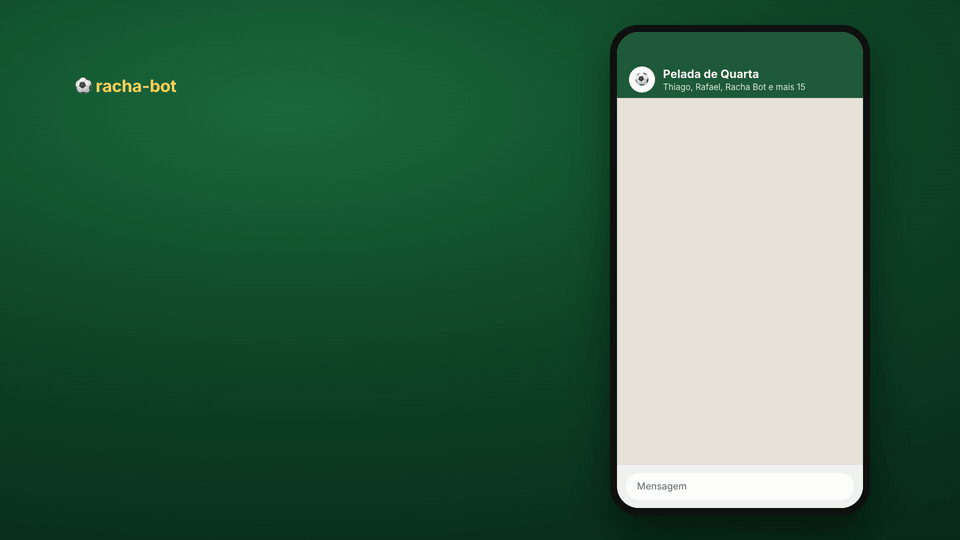
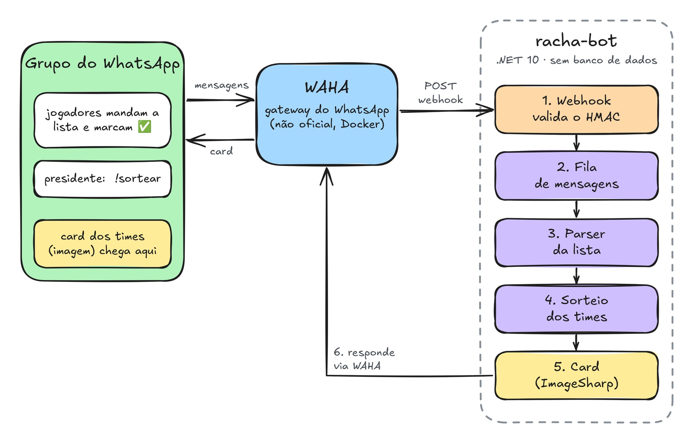
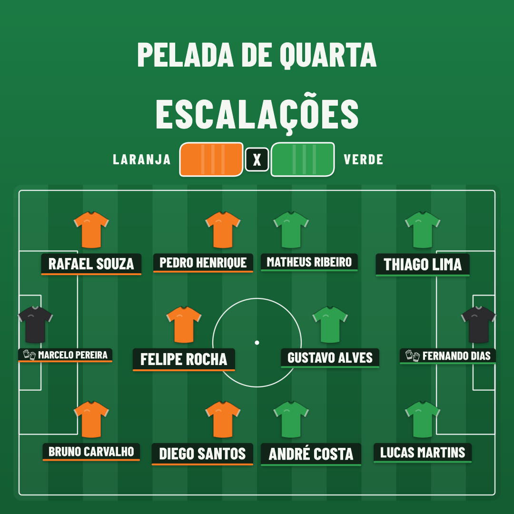

# racha-bot

[](https://github.com/DeVFirmino/racha-bot/actions/workflows/ci.yml)
[](https://dotnet.microsoft.com/download/dotnet/10.0)
[](https://docs.docker.com/compose/)
[](LICENSE)

**O sorteio dos times da pelada, direto no grupo do WhatsApp.**

<p align="center">
  <a href="docs/img/racha-bot-fluxo.mp4"></a>
</p>

Você conhece a cena. A lista passa de mão em mão, alguém reenvia uma cópia velha e um nome some, ninguém lembra quem pagou, e na hora do jogo o sorteio sai no papelzinho.

O racha-bot entra no grupo pra resolver isso. Ele lê a lista do jeito que vocês já escrevem, confere quem marcou ✅ e devolve os times prontos numa imagem. Ninguém precisa instalar app nem aprender nada novo.

É grátis, de código aberto e roda num servidor seu.

## Teste em 1 minuto, sem WhatsApp

Dá para ver o card sair antes de conectar número nenhum. Na raiz do repositório, com Python 3 e o SDK do .NET 10:

```sh
python3 scripts/group-simulator.py --web
```

A página sobe em http://127.0.0.1:8095/. Manda a lista, marca o ✅, troca entre presidente e integrante e usa os comandos. O card aparece no chat. O que o simulador faz por baixo está em [Para desenvolvedores](#para-desenvolvedores).

## Como funciona

1. **O grupo manda a lista como sempre.** Goleiros fixos, jogadores e lista de espera, no texto de sempre.
2. **Quem paga marca o ✅** ao lado do próprio nome.
3. **O presidente responde a lista com `!sortear`.** Em segundos, o bot manda o card dos times e a legenda com as escalações.

<p align="center"></p>

<p align="center"></p>

## O que ele faz por você

- **Entende a lista bagunçada:** numeração, ✅, 🧤, emojis e até as linhas de Pix, valor e horário no meio.
- **Monta times justos:** times de 6 (1 goleiro + 5 na linha) quando dá. Com menos gente, dois times com o mesmo número de jogadores, ou com um de diferença. O goleiro fixo fica no gol, e o time sem goleiro ganha um de rodízio.
- **Só sorteia com todo mundo pago.** Se faltar ✅, ele diz quem falta. Na emergência, `!sortear pagos` sorteia só quem já pagou.
- **Cobra por você:** `!pendentes` mostra no grupo quem ainda não pagou, com o valor e o link de pagamento.
- **Avisa quando a lista está estranha:** nome repetido, nome em duas seções, cópia antiga de outra pessoa.
- **Não vira spam:** só responde a comandos, só no seu grupo e com limite de mensagens.

## Comandos

Manda um destes no grupo. Papo normal ele deixa passar.

| Comando | Quem usa | O que faz |
|---|---|---|
| `!sortear` (ou `!times`) | presidência | Sorteia os times. Respondendo uma lista, usa aquela; sem responder, usa a mais recente da presidência. |
| `!sortear pagos` | presidência | Sorteia só quem tem ✅ (mínimo de 4 jogadores de linha pagos). |
| `!pendentes` (ou `!cobrar`) | todo mundo | Mostra quem ainda não pagou. Quem não é da presidência pode usar de tempos em tempos. |
| `!ajuda` | todo mundo | Explica como participar e lista os comandos. |

A lista precisa dos títulos `Goleiros fixos`, `Lista de jogadores` e `Lista de espera`:

```text
⚽ PELADA DE QUARTA ⚽
Quarta, 20:30 · Quadra do Parque

Goleiros fixos:
1. Marcelo Pereira 🧤
2. Fernando Dias 🧤

Lista de jogadores:
1. Rafael Souza ✅
2. Thiago Lima ✅
3. Bruno Carvalho ✅
4. Lucas Martins ✅
...

Lista de espera:
1. Caio Mendes
```

A presidência é quem você cadastra no bot (até 2 pessoas). Ser admin do grupo no WhatsApp não dá acesso ao sorteio.

Os nomes e lugares dos exemplos são fictícios.

## Antes de instalar

- **Um número de WhatsApp só para o bot.** Use um chip dedicado, nunca o seu número pessoal. O bot entra no grupo como um aparelho conectado desse número, pelo [WAHA](https://waha.devlike.pro/), um gateway **não oficial**. O WhatsApp não garante que o número não será bloqueado. O bot foi feito para reduzir esse risco, mas ele existe.
- **Um computador ou servidor com Docker** (e Docker Compose).
- **Uma chave gratuita da Six Labors**, a biblioteca que desenha o card. Projetos open source não pagam: peça em [licensing.sixlabors.com](https://licensing.sixlabors.com) para o assembly `PeladaBot`.

## Instalação

1. **Baixe o projeto e crie o `.env`:**

   ```sh
   git clone https://github.com/DeVFirmino/racha-bot.git
   cd racha-bot/deploy
   cp .env.example .env
   ```

   No `.env`, gere `WAHA_API_KEY` e `WAHA_WEBHOOK_HMAC_KEY` com `openssl rand -hex 32`, `WAHA_DASHBOARD_PASSWORD` com `openssl rand -hex 16`, e coloque a sua chave em `SIXLABORS_LICENSE_KEY`. Em `WAHA_ARCH_SUFFIX`, deixe `-arm` num Mac com Apple Silicon ou outra máquina ARM, e vazio numa máquina Intel ou AMD.

2. **Suba o WAHA e conecte o número:**

   ```sh
   docker compose up -d waha
   ```

   Abra http://localhost:3000/dashboard, entre com o login do `.env`, inicie a sessão `default` e escaneie o QR code no celular do chip (WhatsApp → Aparelhos conectados).

3. **Grave o grupo e a presidência no `.env`.**

   a. Adicione o número do bot ao grupo da pelada.

   b. Abra o Swagger em http://localhost:3000. A página pede o login do dashboard (`WAHA_DASHBOARD_USERNAME` e `WAHA_DASHBOARD_PASSWORD`). Autorize as chamadas com a `WAHA_API_KEY`: o WAHA exige essa chave no cabeçalho `X-Api-Key`.

   c. Chame `GET /api/default/groups`. O id do grupo termina em `@g.us`. Esse valor vai em `BOT_GROUP_ID`.

   d. Chame `GET /api/default/groups/{id}/participants`, trocando `{id}` pelo id do passo anterior. O seu id termina em `@c.us` ou `@lid`. Esse valor vai em `BOT_PRESIDENT_ID`.

4. **Ligue o bot:**

   ```sh
   docker compose up --build -d
   ```

   Mande `!ajuda` no grupo. Se ele responder, está pronto.

Para deixar ligado de vez, rode os mesmos dois containers em qualquer servidor com Docker. Guarde o volume do WAHA (`/app/.sessions`): é ele que mantém o número conectado sem pedir o QR code de novo.

## Deu ruim? (problemas comuns)

A bola parou? Quase sempre é uma destas.

### O bot não responde

- **Mandou no grupo errado.** Ele só escuta o grupo do `BOT_GROUP_ID`. Outro grupo, ou o privado, é silêncio.
- **`!sortear` não é cargo de admin.** Quem sorteia é a presidência cadastrada no bot, no máximo duas pessoas. Admin do grupo no WhatsApp não entra nessa lista. Na primeira vez ele fala. A mesma pessoa, nos 10 minutos seguintes (o padrão), manda de novo e ele fica quieto.
- **O comando ficou no meio da frase.** A primeira palavra tem de ser `!sortear`, `!times`, `!pendentes`, `!cobrar` ou `!ajuda`. Maiúscula e acento tanto faz. `bora !sortear` não é comando.
- **A mensagem demorou a chegar.** Mais de 2 minutos entre o envio e o bot receber (o padrão) e ele descarta.
- **O WAHA não está `WORKING`.** Sessão `FAILED` ou `STOPPED`: ele não lê o grupo até voltar.
- **O bot nem subiu.** Sem `BOT_GROUP_ID` ou sem `BOT_PRESIDENT_ID` ele recusa iniciar. O log diz qual falta.
- **A chave do webhook não é a mesma dos dois lados.** O WAHA assina com `WAHA_WEBHOOK_HMAC_KEY` e o bot confere essa chave. Se divergir, a resposta é 401 e o comando nem entra na fila. No Compose, uma variável só alimenta os dois.
- **Respondeu demais.** No padrão, 30 envios numa janela de 1 hora e ele segura os próximos. É o freio para não parecer spam.

### Pediu o QR code de novo

O número conectado mora em `/app/.sessions` (no Compose, o volume `waha_sessions`). Sumiu o volume, o WhatsApp desconecta e o dashboard pede o QR outra vez. Não apague esse volume.

### O sorteio parou por falta de ✅

`!sortear` espera a lista de jogadores inteira com ✅. Quem está na espera sem ✅ não segura o jogo. `!pendentes` mostra os nomes. Se a presidência quiser sortear mesmo assim, `!sortear pagos` entra só com quem já pagou, no mínimo 4 jogadores de linha.

### O número foi bloqueado

O caminho até o WhatsApp é o WAHA, e ele não é oficial. Bloqueio de número pode acontecer. Chip dedicado para o bot, nunca o seu. O bot responde pouco para diminuir o risco, mas o risco fica.

## Personalizar

Tudo fica no [`appsettings.json`](src/PeladaBot/appsettings.json), e cada item também pode vir por variável de ambiente.

| O quê | Onde |
|---|---|
| Fuso dos horários | `Bot:Fuso` (ex.: `America/Sao_Paulo`) |
| A presidência (até 2 pessoas, com um ou mais ids cada) | `Bot:Grupos:0:Presidencia` |
| Valor e link de pagamento | `Bot:Grupos:0:ValorDaPelada` e `LinkDePagamento` |
| Nome e escudo do grupo no card | `Bot:Grupos:0:TituloDoCard` e `CaminhoDoEscudo` |
| Frases do rodapé, temas da legenda e recados de cobrança | `Bot:Grupos:0:FrasesDoRodape`, `ModelosDaLegenda` e `MensagensDeCobranca` |

## Para desenvolvedores

O bot é uma API em .NET 10 que recebe os webhooks do WAHA, coloca os comandos numa fila e responde pelo próprio WAHA. Não tem banco de dados. O desenho desse caminho está em `docs/img/fluxo.png`; a fonte editável é `docs/img/fluxo.excalidraw`.

```sh
dotnet build
dotnet test --solution PeladaBot.slnx
```

Para ver o bot responder sem celular e sem WhatsApp, use o simulador do grupo. Ele sobe o bot com um WAHA falso e abre uma tela parecida com a do WhatsApp em http://127.0.0.1:8095/:

```sh
python3 scripts/group-simulator.py --web
```

Lá você manda a lista, marca quem pagou, troca entre presidente e integrante e usa os comandos. O card aparece no chat. O atalho, sem o resto da instalação, está em [Teste em 1 minuto, sem WhatsApp](#teste-em-1-minuto-sem-whatsapp).

Quer ajudar? Veja o [guia de contribuição](.github/CONTRIBUTING.md).

## Licença

[MIT](LICENSE). As fontes do card (Barlow Condensed e Noto Emoji) estão sob a [SIL Open Font License](src/PeladaBot/Card/Fonts/BarlowCondensed/OFL.txt).
